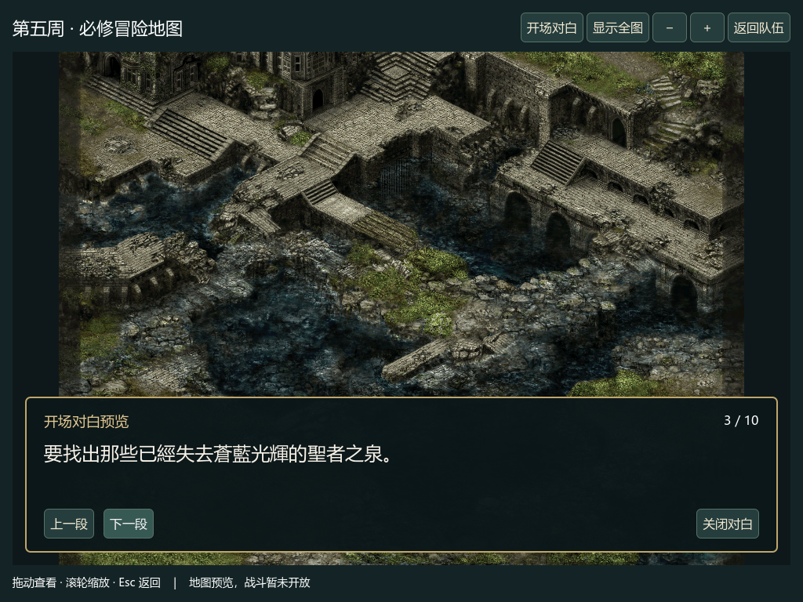

# 首条文字与图形开场预览验收（2026-10-12）

Godot MAP05地图上新增十段原版开场对白预览。第五周队伍就绪后，从「必修冒险 · 出发准备」进入「查看本关地图」→「开场对白」。可翻页、关闭；原图拖动和缩放仍可用。

原版验证完成自然文字激活、首句查找/分行和文字记录准备，停在CreateFontA入口第一条指令前。独立源码模型与三组八个完整区域、嵌套帧、原始字体栈输入及绘图序列全部一致；其余119496650字节保持原值。七个父阶段完整比较，两个拒绝继承不可变父证据。

原文目录按T0005十条文字指令順序提取，不表示后九条原版指令已执行。预览不补写发言者或演出，不完成冒险、不改学校状态或存档。字体API、文字排版/就绪、波次和完整任务/世界调度仍待推进。

Python245项、Godot62套件409项、最终对白窗口153项、地图兼容100项、严格规格30项通过；初版151项也保留。18张截图均已目视检查。426个未受影响文件和十项v4存档指纹保持原字节。94/94表示当前规划阶段完成，项目全年流程尚未完成。分阶段本地提交，未push。

[原版报告](../school-text-preparation-v1-20261012.json) · [来源与操作](../../docs/school_text_preparation.md) · [验收数据](acceptance.json) · [working/index/HEAD清单](verification.json) · [对白窗口](../school-opening-dialogue-ui-v2-20261012/README.md) · [地图兼容](../school-opening-dialogue-map-ui-v1-20261012/README.md)

下一步从保留的自然字体请求继续文字排版与就绪，再推进事件/波次和学校阵容图形战斗。
